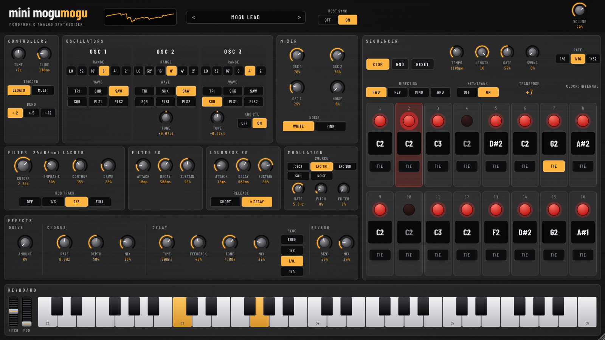

# mini mogumogu (VST3 / AU)



`synthesizer/mini-mogumogu.html`（Minimoog 系モノフォニックシンセ＋エフェクト＋16ステップシーケンサー）を VST3 / AU プラグイン化したものです。JUCE + C++。ソースは1つで、Windows 用と Mac 用は GitHub Actions が自動でビルドします。ブラウザ版と同じ黒いブラシドアルミの横長パネル（16:9）を専用 GUI として持ちます。

## できること
- 音源：3オシレーター（TRI / SHK / SAW / SQR / PLS1 / PLS2）＋ノイズ（WHITE / PINK）、24dB/oct ラダーフィルター（ドライブ付き）、フィルター EG・アンプ EG、グライド、モジュレーション（OSC3 / LFO TRI / LFO SQR / S&H / NOISE）
- エフェクト：ドライブ、コーラス、ディレイ（FREE / 1/8 / 1/8. / 1/4、DAW のテンポに同期）、リバーブ、出力コンプレッサー
- シーケンサー：16ステップ（ON / ノート C1〜C5 / TIE）、LENGTH、GATE、SWING、RATE（1/8・1/16・1/32）、方向（FWD / REV / PING / RND）、KEY>TRANS
- **RUN**：シーケンサーのオン／オフ（初期は OFF。OFF の間は MIDI 鍵盤で普通に弾けます）
- **HOST SYNC ON（既定）**：RUN が ON のとき、DAW の再生／停止・テンポ・再生位置に合わせて鳴ります
- **HOST SYNC OFF**：RUN が ON のとき、`TEMPO`（内部クロック）で単体でも鳴ります（Standalone 版もこちら）
- MIDI：ノート、ピッチベンド、モジュレーションホイール、CC（1, 5, 7, 71〜75, 91, 93）、All Notes Off（120, 123）
- プリセット：工場出荷 10 音色（DAW のプログラム切替／画面上部の PRESET 欄）。つまみ・シーケンスの状態は DAW のプロジェクトに保存されます
- 画面：固定比率でリサイズ可能（幅 640〜3840px）。PC キーボード（A W S E D F T G Y H U J K O L P ;、Z / X でオクターブ、スペースで RUN）

## ブラウザ版との違い
- MP3 録音、プリセットの JSON 入出力、MIDI デバイス選択はありません（DAW の録音・プリセット機能・MIDI 設定を使ってください）
- オシレーターの位相は自走で、ブラウザ版と波形の頭がそろうわけではありません（音色は同じ）
- ドライブは 2 倍オーバーサンプリングの代わりに ADAA（アンチエイリアス処理）を使っています
- 出力コンプレッサーはブラウザ版の DynamicsCompressor の静特性を測って近似しています
- LFO / S&H / ノイズは乱数・位相が毎回変わります

## ビルド
```
cmake -S . -B build -DCMAKE_BUILD_TYPE=Release
cmake --build build --config Release --target MiniMogumogu_VST3      # Mac は MiniMogumogu_AU も
```
成果物：`build/MiniMogumogu_artefacts/Release/VST3/mini mogumogu.vst3`。GitHub に push すれば Actions（`.github/workflows/mini-mogumogu-build.yml`）が Windows（インストーラー .exe）と macOS（Universal の .dmg）を作り、Artifacts からダウンロードできます。

## 検証
- `tests/run_tests.sh <mini-mogumogu.html>`：音源エンジンを、ブラウザ版の**実際の Web Audio グラフ**（Chromium の OfflineAudioContext）と同じ演奏で比較します（26シナリオ）。オシレーターの位相は自走でそろわないため、位相ずれを補正した相関で見ます。波形・フィルター・エンベロープ・ドライブ・コーラス・グライドなど多くは相関 0.97〜0.999、RMS は ±1dB 以内（ベンド 0.93、OSC3 モジュレーション 0.89、全エフェクト 0.96 はやや低め。LFO / S&H / ノイズ系は位相・乱数が違うため波形は一致しません）
- ディレイ：ブラウザ版はフィードバック経路の都合で繰り返しごとに 128 サンプル（約2.7ms）遅れますが、VST 版は DAW のテンポ同期を優先して遅れを入れていません。エコーの音量は、ノイズ入力で原音との比を測り、FEEDBACK / TONE を変えても ±1dB 以内でブラウザ版と一致を確認しました
- リバーブ：ブラウザ版と同じ作り方のインパルス応答（コンボルバーの正規化も同じ）。余韻の大きさはブラウザ版と ±0.7dB 以内で一致を確認（乱数なので波形は一致しません）
- `tests/PluginSmoke.cpp`（`-DMM_BUILD_TESTS=ON`）：プラグイン全体（MIDI、内部クロック、DAW クロック、KEY>TRANS、全プリセット、リバーブ、状態保存、ランダム操作）
- `tests/GuiShot.cpp`：エディターを画像に書き出してレイアウトを確認
- `pluginval` strictness 5（エディターを開くテストを含む）合格（Linux）
