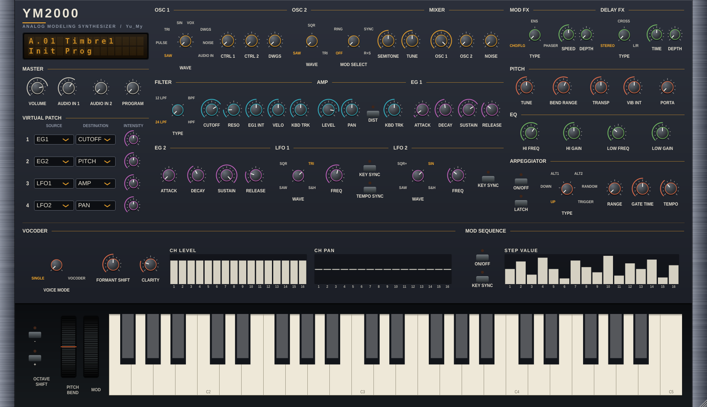

# YM2000 (VST3 / AU)

無料のアナログモデリング・シンセサイザー。ダウンロードは [Releases](../../releases)、使い方は [取扱説明書](docs/MANUAL.md)。

`synthesizer/ms2000-synth.html`（Yu_My_FX）の音源を VST3 / AU プラグイン化したものです。JUCE + C++。**ソースは1つ**で、Windows 用と Mac 用はビルドするだけで作り分けます（GitHub Actions が両方を自動ビルド）。

## できること（HTML版と同じ）
- 4音ポリ、OSC1（SAW/PULSE/TRI/SIN/VOX/DWGS/NOISE/AUDIO IN）、OSC2（RING/SYNC）、フィルター4種、EG×2、LFO×2
- Virtual Patch×4、Mod Sequence、アルペジエーター、16バンド・ヴォコーダー
- Mod FX（CHO/FLG・ENS・PHASER）、Delay FX、EQ、リミッター
- パラメーターは全部 DAW のオートメーション対象（約 150 個）。音色は DAW のプロジェクトとプリセットに保存
- **GUI**：実機に近い配置（左：LCD・マスター・バーチャルパッチ／中央：OSC〜EG・LFO／右：FX・ピッチ・EQ・アルペジエーター／下段：ヴォコーダー・Mod Seq／最下段：44鍵・ベンド・モジュレーションホイール）。見た目は濃紺のパネル＋木目のサイド＋セクション別の色リング付きつまみ＋アンバーのLCD＋クリーム色の鍵盤。未使用の TIMBRE/SHIFT/WRITE/MIC/FILE/SOURCE は省いて詰めて配置。ウィンドウはリサイズ可。つまみは上下ドラッグ（Shift で微調整）、ダブルクリックで初期値、ホイール操作可
- MIDI：ノート、ピッチベンド、CC1(モジュレーション)、CC64(サスティン)、CC120/123(オールノートオフ)、プログラムチェンジ(工場音色8種)

## HTML版との違い
- WRITE / SHIFT / TIMBRE ボタンと 128 スロットの音色メモリーは無し（音色は DAW 側に保存。PROGRAM つまみは工場音色 8 種）
- ヴォコーダーの声（モジュレーター）は、MIC/FILE/DEMO ではなく **DAW の入力（サイドチェイン）**。`Audio In / Sidechain` を有効にしてルーティングする
- アルペジエーター／Mod Seq／LFO1 のテンポ同期は、通常 `TEMPO` つまみの値を使います。ARPEGGIATOR 見出し帯の **HOST SYNC** を ON にすると DAW のテンポに追従し（再生中は拍のグリッドにも同期）、DAW がテンポを渡さない場合は `TEMPO` つまみの値に戻ります。HOST SYNC は音色ではなく全体設定として保存されます
- MIDI 入力の最低ノート制限は無し（ノート番号をそのまま使用。`Pitch Transpose` あり）。画面のオクターブボタンはパソコンキーボード入力の音域を変えます
- 遅延（レイテンシ）6ms（リミッターのルックアヘッド。DAW が自動補正）

## ビルド
```
cmake -S . -B build -DCMAKE_BUILD_TYPE=Release
cmake --build build --config Release --target YM2000_VST3      # Mac は YM2000_AU も
```
成果物：`build/YM2000_artefacts/Release/VST3/YM2000.vst3`
GitHub に push すれば Actions（`.github/workflows/build.yml`）が Windows / macOS(Universal) 用を作り、Artifacts からダウンロードできます。

### 置き場所
- Windows: `C:\Program Files\Common Files\VST3\`
- Mac: `/Library/Audio/Plug-Ins/VST3/`（AU は `.../Components/`）。ダウンロードしたものは `xattr -cr YM2000.vst3` が必要な場合あり（未署名のため）

## 画面


## 検証
- `tests/run_tests.sh <ms2000-synth.html>`：音源エンジンを HTML 版（JS）と同じ演奏で比較 → 23パターンで**ビット一致**（誤差 4e-9 以下）
- FX は本物の Chromium の Web Audio で元グラフを動かして比較 → 誤差 0.3〜3%（音量差 0.1dB 前後）
- `pluginval` strictness 5 合格（Linux）、エディターを開くテストも合格。`tests/PluginSmoke.cpp`（`-DYM_BUILD_TESTS=ON`）で発音・アルペジエーター・プログラム・状態保存を確認。`tests/GuiShot.cpp` で画面を PNG に書き出して確認
- Windows / Mac での実機ビルド・DAW 動作確認は未実施（CI でビルドを確認してください）

## ライセンス
フリーウェアです（[LICENSE.txt](LICENSE.txt)）。JUCE を使用しており、JUCE の Starter ライセンス（年間収益 $20,000 まで）の条件に従って配布します。ソースコードの複製・改変・再配布には作者の許可が必要です。使い方は [docs/MANUAL.md](docs/MANUAL.md) を参照してください。

## macOS へのインストール（補足）

CI の成果物は `YM2000-macOS.tar.gz` です（zip だと実行権限が失われ、DAW から見えなくなるため）。ダウンロード後に解凍し、`YM2000.vst3` を `~/Library/Audio/Plug-Ins/VST3/`、`YM2000.component` を `~/Library/Audio/Plug-Ins/Components/` に置いてください。アドホック署名済みですが公証はしていないので、ブラウザ経由でダウンロードした場合は `xattr -cr` で隔離属性を外してください。
